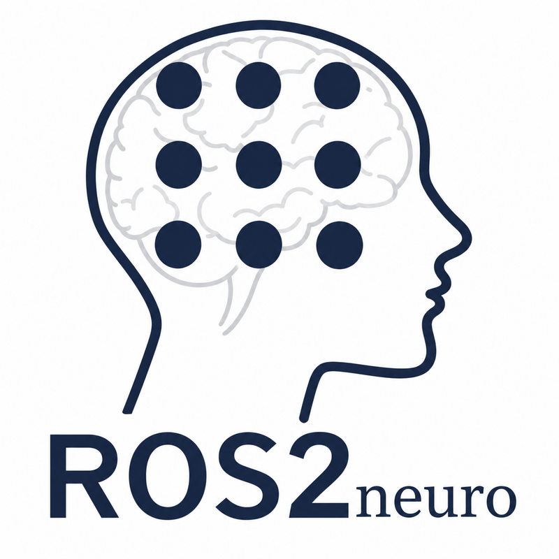
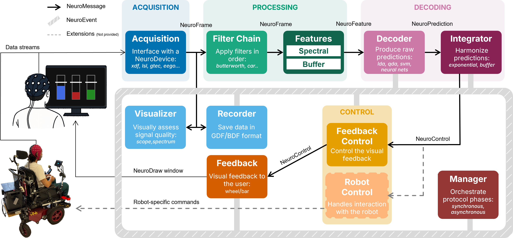
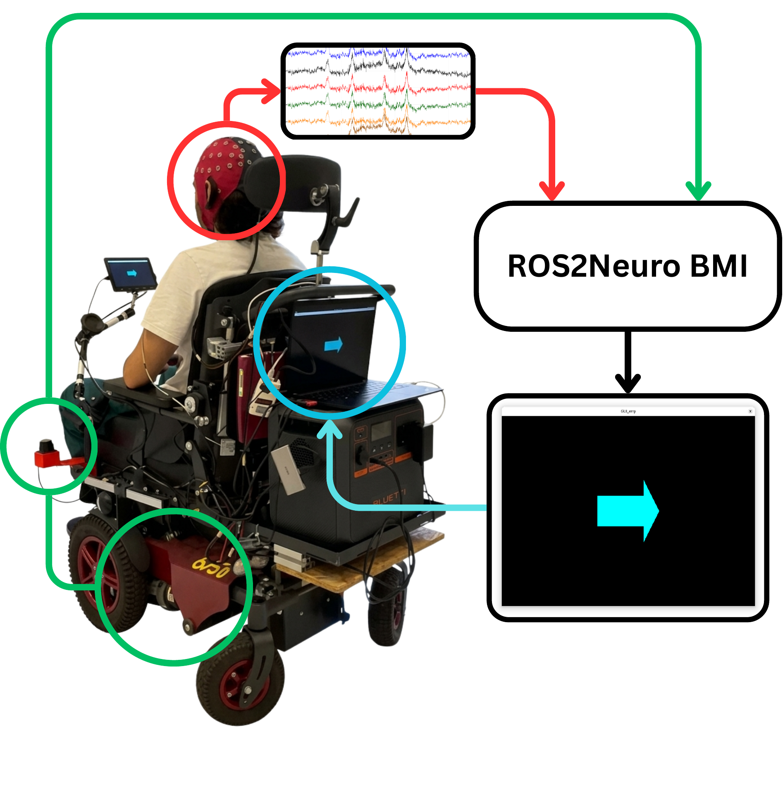
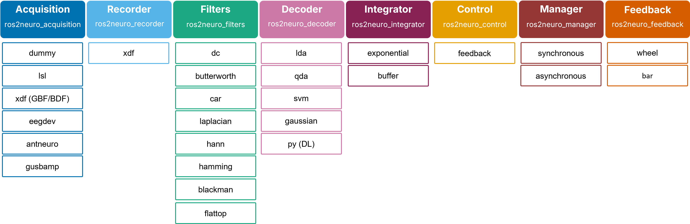

<p align="center">
  
</p>

# ros2neuro: Closed-Loop Brain–Computer Interfaces with Modular ROS 2 Components

**ros2neuro** is the ROS 2 successor of [ROS-Neuro](https://github.com/rosneuro): an open-source C++17 framework that builds a closed-loop brain–computer interface (BCI) out of ordinary ROS 2 nodes. Acquisition back-ends, filters, decoders, integrators, control, experimental protocols and feedback displays are interchangeable **plugins** that exchange a handful of typed messages (`NeuroFrame`, `NeuroFeature`, `NeuroPrediction`, `NeuroControl`, `NeuroEvent`). Neural signals become a data source at the same level as cameras, inertial sensors and controllers, and the BCI lives in the same graph as the robot it drives.

📖 **Documentation, concepts and tutorials: <https://ros2neuro.github.io/docs/>**

---

## 1. Installation

There are three ways to get ros2neuro. Everything was built and tested on **Ubuntu 24.04 (noble) + ROS 2 Jazzy**.

| | Way | Use it when |
|---|---|---|
| [1.1](#11-from-the-command-line-apt) | **Command line**: `apt install` | you are on Ubuntu 24.04 with [ROS 2 Jazzy](https://docs.ros.org/en/jazzy/Installation.html) and just want to use ros2neuro |
| [1.2](#12-docker-podman-or-distrobox) | **Docker / Podman / Distrobox** | you are on another Linux, or want to try it without touching your system |
| [1.3](#13-download-the-repositories-and-build-them) | **Download the repositories** and build with `colcon` | you want to modify the code, write a plugin, or use the acquisition plugins that need a proprietary SDK |

### 1.1 From the command line (apt)

ros2neuro is distributed as Debian packages signed by ros2neuro.github.io.

```bash
# 1. the key and the source list
curl -fsSL https://ros2neuro.github.io/ppa/ubuntu/ros2neuro-key.asc | gpg --dearmor | sudo tee /etc/apt/trusted.gpg.d/ros2neuro-key.gpg > /dev/null
sudo curl -fsSL -o /etc/apt/sources.list.d/ros2neuro.list https://ros2neuro.github.io/ppa/ubuntu/ros2neuro.list

# 2. the whole stack
sudo apt update
sudo apt install ros-jazzy-ros2neuro-full
```

`ros-jazzy-ros2neuro-full` installs everything **except** the acquisition plugins that need a proprietary SDK (`ros2neuro_acquisition_antneuro`, `ros2neuro_acquisition_gusbamp`), which must be built from source (1.3). A single package can be installed on its own, e.g. `sudo apt install ros-jazzy-ros2neuro-filters`: the name is `ros-jazzy-` plus the package name with dashes.

Optional, to let `rosdep` resolve the ros2neuro packages when you build your own packages that depend on them:

```bash
echo "yaml https://ros2neuro.github.io/ppa/ubuntu/rosdep-ros2neuro-packages.yaml" | sudo tee /etc/ros/rosdep/sources.list.d/20-ros2neuro.list
rosdep update
```

Check it (no hardware needed):

```bash
source /opt/ros/jazzy/setup.bash
ros2 launch ros2neuro_acquisition_dummy dummy_acquisition.launch.py
```

### 1.2 Docker, Podman or Distrobox

An image with Ubuntu 24.04, ROS 2 Jazzy and ros2neuro already installed from the apt repository. The [`Dockerfile`](https://github.com/ros2neuro/ppa/blob/main/docker/Dockerfile) is in the [`ppa`](https://github.com/ros2neuro/ppa) repository. It works with Docker and with Podman (replace `docker` with `podman`); amd64 only.

```bash
git clone https://github.com/ros2neuro/ppa.git
docker build -t ros2neuro ppa/docker/
```

Run the whole chain on a recorded GDF and open the feedback window (the wheel):

```bash
xhost +local:                                     # let the container open windows on your screen
docker run -it --rm \
    -e DISPLAY=$DISPLAY -e LIBGL_ALWAYS_SOFTWARE=1 -v /tmp/.X11-unix:/tmp/.X11-unix --network host \
    ros2neuro ros2 launch ros2neuro_devel_test gaussian_wheel.launch.xml protocol:=calibration record:=false
xhost -local:                                     # when you are done
```

With **Distrobox** the container shares your screen, home folder and devices, so no `xhost` or `-v` options are needed:

```bash
podman build -t ros2neuro_ppa ppa/docker/                                  # or: docker build ...
distrobox create --name ros2neuro_ppa --image localhost/ros2neuro_ppa
distrobox enter ros2neuro_ppa

# inside the container
source /opt/ros/jazzy/setup.bash
ros2 launch ros2neuro_devel_test gaussian_wheel.launch.xml protocol:=calibration record:=false
```

Notes on the GPU, the recordings, real amplifiers and LSL streams: [installation page of the documentation](https://ros2neuro.github.io/docs/installation/).

### 1.3 Download the repositories and build them

Every package is its own repository in this organization. Clone the ones you need (or all of them) in the `src/` folder of a colcon workspace and build:

```bash
source /opt/ros/jazzy/setup.bash
sudo apt install ros-dev-tools python3-rosdep            # colcon, rosdep (once)
mkdir -p ~/ros2neuro_ws/src && cd ~/ros2neuro_ws/src
for r in \
    ros2neuro_msgs ros2neuro_data ros2neuro_acquisition \
    ros2neuro_acquisition_dummy ros2neuro_acquisition_xdf ros2neuro_acquisition_lsl \
    ros2neuro_acquisition_eegdev ros2neuro_acquisition_antneuro ros2neuro_acquisition_gusbamp \
    ros2neuro_recorder ros2neuro_recorder_xdf ros2neuro_visualizer \
    ros2neuro_filters ros2neuro_filters_dc ros2neuro_filters_butterworth \
    ros2neuro_filters_car ros2neuro_filters_laplacian ros2neuro_filters_blackman \
    ros2neuro_filters_flattop ros2neuro_filters_hamming ros2neuro_filters_hann \
    ros2neuro_processing_spectral ros2neuro_processing_buffer ros2neuro_decoder \
    ros2neuro_decoder_lda ros2neuro_decoder_qda ros2neuro_decoder_svm \
    ros2neuro_decoder_gaussian ros2neuro_decoder_sklearn ros2neuro_decoder_braindecode ros2neuro_decoder_py ros2neuro_decoder_converters \
    ros2neuro_integrator ros2neuro_integrator_exponential ros2neuro_integrator_buffer \
    ros2neuro_control ros2neuro_control_feedback ros2neuro_manager \
    ros2neuro_manager_synchronous ros2neuro_manager_asynchronous ros2neuro_feedback \
    ros2neuro_feedback_wheel ros2neuro_feedback_bar neurodraw \
    ros2neuro_devel_test
do git clone https://github.com/ros2neuro/$r.git; done

cd ~/ros2neuro_ws
rosdep install --from-paths src --ignore-src -r -y
colcon build                                       # or: colcon build --packages-select <package>
source install/setup.bash
```

* `neurodraw` (the graphics library of the feedback) is plain CMake: `colcon` builds it first.
* The acquisition plugins for a proprietary SDK (`ros2neuro_acquisition_antneuro`, `ros2neuro_acquisition_gusbamp`) need the SDK installed: skip them with `colcon build --packages-skip ros2neuro_acquisition_antneuro ros2neuro_acquisition_gusbamp`.
* A workspace sourced **after** `/opt/ros/jazzy` overlays the installed packages: install from apt and rebuild only the package you work on.

### Try it

With any of the three, the whole chain without hardware (a GDF replayed through the filters, the decoder, the integrator, the control and the feedback):

```bash
ros2 launch ros2neuro_devel_test gaussian_4class_bars.launch.xml protocol:=control record:=false
```

The [hardware-free tutorial](https://ros2neuro.github.io/docs/tutorials/hardware-free-pipeline/) explains it step by step, and `ros2neuro_devel_test` has launchers for the three protocols (calibration, evaluation, control).

---

## 2. How ros2neuro works

A closed-loop BCI is a distributed real-time system: neural samples are acquired, filtered, decoded and accumulated into a command while a person watches a feedback and an experimental protocol (calibration, evaluation, control) runs. ros2neuro implements every step of this loop as a separate node, so each research group can replace or add a single component (a new amplifier, a new decoder, a new feedback, a robot) without touching the rest. It is designed first of all for endogenous BCIs (e.g. motor imagery) and for continuous, self-paced control of assistive devices such as wheelchairs and telepresence robots.



<p align="center">
  
</p>

### The loop

The **signal chain** (acquisition → filter chain → features → decoder → integrator, the top row) turns the amplifier signal into class probabilities. **Control** decides what to do with them (thresholds, outcome of a trial, reset of the integrator) and sends the values to the **feedback**, which the subject sees: that closes the loop. The **manager** runs the trials of an experiment and writes their phases on an event bus (the hatched frame), where the control and the feedback also talk and from which the recorder stores everything next to the signal. The dashed boxes are extensions that are not part of the stack: the *Robot Control* is **your** plugin, a second control that takes the same predictions and drives a robot. The loop is explained in the [architecture page](https://ros2neuro.github.io/docs/concepts/architecture/) of the documentation.

Two rules are worth knowing. Only two kinds of service call exist, the acquisition services (`start`, `stop`, `quit`) and the integrator **reset** that control asks for: there are no ROS actions. And every node reads **its own parameters**; what several nodes share (the classes, the ids of the events, the thresholds) is one global `/**` section of the parameter file that each of them loads, and no node asks another for a parameter ([protocols](https://ros2neuro.github.io/docs/concepts/protocols/), [shared parameters](https://ros2neuro.github.io/docs/concepts/shared-parameters/)).

### The plugins

Each colour is a **family**: a package that defines a base class and a generic node, and under it the plugins available (amplifiers, filters, decoders, integrators, recorders, control, protocols, drawings). Each plugin is a separate package that registers against the base class and is chosen at run time by a parameter. The classes and their pluginlib ids are in the [plugins page](https://ros2neuro.github.io/docs/concepts/plugins/).



| Family | Parent class | Plugin classes |
|---|---|---|
| acquisition | `ros2neuro::acquisition::NeuroDevice` | `DummyDevice`, `LSLDevice`, `EGDDevice`, `EEGODevice`, `GUSBampDevice`, `XDFDevice` |
| filters | `ros2neuro::filters::Filter<float>` | `DcFloat`, `ButterworthFloat`, `CarFloat`, `LaplacianFloat`, `HannFloat`, `HammingFloat`, `BlackmanFloat`, `FlattopFloat` (instances of the templates `Dc<T>`, ...) |
| decoder | `ros2neuro::decoder::Decoder` | `Gaussian`, `LDA`, `QDA`, `SVM`, `Sklearn`, `Braindecode` |
| integrator | `ros2neuro::integrator::Integrator` | `Exponential`, `Buffer` |
| recorder | `ros2neuro::recorder::NeuroRecorder` | `XDFRecorder` |
| control | `ros2neuro::control::Control` | `ros2neuro::control::Feedback` |
| manager | `ros2neuro::manager::Manager` | `Synchronous`, `Asynchronous` |
| feedback | `ros2neuro::feedback::Feedback` | `Wheel`, `Bar` |

Parent and plugins share the namespace `ros2neuro::<family>`.

---

## 3. ros2neuro packages

Every package is a separate repository. Details, parameters and topics of each one are in the [package documentation](https://ros2neuro.github.io/docs/packages/).

**Core**
- [**ros2neuro_msgs**](https://github.com/ros2neuro/ros2neuro_msgs) Standard messages of the ros2neuro framework
- [**ros2neuro_data**](https://github.com/ros2neuro/ros2neuro_data) Data structures of the ros2neuro framework

**Acquisition**
- [**ros2neuro_acquisition**](https://github.com/ros2neuro/ros2neuro_acquisition) Generic interface for acquiring data from different devices
- [**ros2neuro_acquisition_dummy**](https://github.com/ros2neuro/ros2neuro_acquisition_dummy) Acquisition plugin generating synthetic signals (no hardware)
- [**ros2neuro_acquisition_xdf**](https://github.com/ros2neuro/ros2neuro_acquisition_xdf) Acquisition plugin replaying GDF/BDF files
- [**ros2neuro_acquisition_lsl**](https://github.com/ros2neuro/ros2neuro_acquisition_lsl) Acquisition plugin for LSL streams
- [**ros2neuro_acquisition_eegdev**](https://github.com/ros2neuro/ros2neuro_acquisition_eegdev) Acquisition plugin for the eegdev library
- [**ros2neuro_acquisition_antneuro**](https://github.com/ros2neuro/ros2neuro_acquisition_antneuro) Acquisition plugin for ANT Neuro eego amplifiers
- [**ros2neuro_acquisition_gusbamp**](https://github.com/ros2neuro/ros2neuro_acquisition_gusbamp) Acquisition plugin for g.tec g.USBamp amplifiers

**Recording and visualization**
- [**ros2neuro_recorder**](https://github.com/ros2neuro/ros2neuro_recorder) Generic interface for recording neuro data
- [**ros2neuro_recorder_xdf**](https://github.com/ros2neuro/ros2neuro_recorder_xdf) Recorder plugin for GDF/BDF files
- [**ros2neuro_visualizer**](https://github.com/ros2neuro/ros2neuro_visualizer) Scope and spectrum viewer for EEG/EMG data

**Filters**
- [**ros2neuro_filters**](https://github.com/ros2neuro/ros2neuro_filters) Generic filters and filter chain for neuro data
- [**ros2neuro_filters_dc**](https://github.com/ros2neuro/ros2neuro_filters_dc) Filters plugin for DC removal
- [**ros2neuro_filters_butterworth**](https://github.com/ros2neuro/ros2neuro_filters_butterworth) Filters plugin for Butterworth filter
- [**ros2neuro_filters_car**](https://github.com/ros2neuro/ros2neuro_filters_car) Filters plugin for CAR filter
- [**ros2neuro_filters_laplacian**](https://github.com/ros2neuro/ros2neuro_filters_laplacian) Filters plugin for Laplacian filter
- [**ros2neuro_filters_blackman**](https://github.com/ros2neuro/ros2neuro_filters_blackman) Filters plugin for Blackman window
- [**ros2neuro_filters_flattop**](https://github.com/ros2neuro/ros2neuro_filters_flattop) Filters plugin for Flattop window
- [**ros2neuro_filters_hamming**](https://github.com/ros2neuro/ros2neuro_filters_hamming) Filters plugin for Hamming window
- [**ros2neuro_filters_hann**](https://github.com/ros2neuro/ros2neuro_filters_hann) Filters plugin for Hann window

**Processing**
- [**ros2neuro_processing_spectral**](https://github.com/ros2neuro/ros2neuro_processing_spectral) Spectral features (FFT, Welch PSD, spectrogram)
- [**ros2neuro_processing_buffer**](https://github.com/ros2neuro/ros2neuro_processing_buffer) Sliding-window buffer of neuro data

**Decoding and integration**
- [**ros2neuro_decoder**](https://github.com/ros2neuro/ros2neuro_decoder) Generic interface for decoders (`.r2nd` models + `manifest.yaml`)
- [**ros2neuro_decoder_lda**](https://github.com/ros2neuro/ros2neuro_decoder_lda) Decoder plugin for LDA
- [**ros2neuro_decoder_qda**](https://github.com/ros2neuro/ros2neuro_decoder_qda) Decoder plugin for QDA
- [**ros2neuro_decoder_svm**](https://github.com/ros2neuro/ros2neuro_decoder_svm) Decoder plugin for SVM
- [**ros2neuro_decoder_gaussian**](https://github.com/ros2neuro/ros2neuro_decoder_gaussian) Decoder plugin for Gaussian classifier
- [**ros2neuro_decoder_sklearn**](https://github.com/ros2neuro/ros2neuro_decoder_sklearn) Decoder plugin for scikit-learn models (skops)
- [**ros2neuro_decoder_braindecode**](https://github.com/ros2neuro/ros2neuro_decoder_braindecode) Decoder plugin for deep-learning models of braindecode (PyTorch)
- [**ros2neuro_decoder_py**](https://github.com/ros2neuro/ros2neuro_decoder_py) Python decoder node for deep-learning models
- [**ros2neuro_decoder_converters**](https://github.com/ros2neuro/ros2neuro_decoder_converters) Converters from Matlab decoders to `.r2nd`
- [**ros2neuro_integrator**](https://github.com/ros2neuro/ros2neuro_integrator) Generic interface for evidence accumulation
- [**ros2neuro_integrator_exponential**](https://github.com/ros2neuro/ros2neuro_integrator_exponential) Integrator plugin for exponential smoothing
- [**ros2neuro_integrator_buffer**](https://github.com/ros2neuro/ros2neuro_integrator_buffer) Integrator plugin based on a buffer of predictions

**Control, protocols and feedback**
- [**ros2neuro_control**](https://github.com/ros2neuro/ros2neuro_control) Generic control layer: the parent class of the control plugins (input: the integrator output) and their node
- [**ros2neuro_control_feedback**](https://github.com/ros2neuro/ros2neuro_control_feedback) Control plugin that drives the feedback: thresholds, outcome of the trials and flow of the feedback (calibration, evaluation, control)
- [**ros2neuro_manager**](https://github.com/ros2neuro/ros2neuro_manager) Generic protocol manager: runs the trials and writes the events on the event bus
- [**ros2neuro_manager_synchronous**](https://github.com/ros2neuro/ros2neuro_manager_synchronous) Manager plugin `Synchronous`: the trials of a calibration or an evaluation
- [**ros2neuro_manager_asynchronous**](https://github.com/ros2neuro/ros2neuro_manager_asynchronous) Manager plugin `Asynchronous`: continuous control, no trials
- [**ros2neuro_feedback**](https://github.com/ros2neuro/ros2neuro_feedback) Generic passive feedback: draws the events of the bus and the control flow
- [**ros2neuro_feedback_wheel**](https://github.com/ros2neuro/ros2neuro_feedback_wheel) Feedback plugin drawing a wheel
- [**ros2neuro_feedback_bar**](https://github.com/ros2neuro/ros2neuro_feedback_bar) Feedback plugin drawing one bar per class
- [**neurodraw**](https://github.com/ros2neuro/neurodraw) SDL2/OpenGL 2D graphics library for BCI feedback

**Examples**
- [**ros2neuro_devel_test**](https://github.com/ros2neuro/ros2neuro_devel_test) Hardware-free launchers (GDF replay) of complete closed loops, and a MATLAB check of the whole chain

---

## References
- Forin P, Simonetto P, et al. ros2neuro: Building Closed-Loop Brain–Computer Interfaces with Modular ROS 2 Components (in preparation)
- Tonin L, Beraldo G, Tortora S, Menegatti E (2022) ROS-Neuro: An Open-Source Platform for Neurorobotics. Front. Neurorobot. 16:886050. doi: 10.3389/fnbot.2022.886050
- Tonin L, Beraldo G, Tortora S, Tagliapietra L, Millàn JdR et al. (2019). ROS-Neuro: A common middleware for BMI and robotics. The acquisition and recorder packages, in Proc of 2019 IEEE International Conference on Systems, Man and Cybernetics (SMC), 2767–2772
- Beraldo G, Tortora S, Menegatti E, Tonin L. (2020). ROS-Neuro: Implementation of a closed-loop BMI based on motor imagery, in Proc of 2020 IEEE International Conference on Systems, Man, and Cybernetics (SMC), 2031–2037
